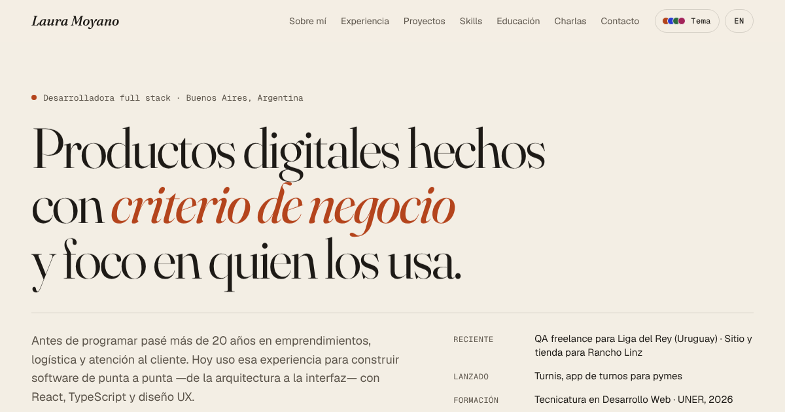

# Laura Moyano — Portfolio

Personal portfolio of **Laura Moyano**, full stack developer based in Buenos Aires, Argentina.
Editorial design, bilingual (ES / EN) and a theme system built on design tokens.

**Live site:** https://laura-m-stack.github.io/laura-moyano-portfolio/



## Highlights

- **Design tokens, not hard-coded colours.** Every component reads semantic tokens
  (`--surface`, `--ink`, `--accent`…). Four palettes × light/dark mode are just
  different values for the same tokens, so adding a palette is two CSS blocks and
  one id.
- **Theme switcher with a View Transition.** The new theme expands as a circle from
  the click point (View Transitions API), with an instant fallback where it isn't
  supported or when the visitor prefers reduced motion. The choice is saved, and an
  inline script applies it before first paint to avoid a flash of the wrong theme.
- **Bilingual content (ES / EN)** from a single typed source, with tests that fail if
  a project, role or talk is missing a translation.
- **Motion with restraint.** Headline word reveal, screenshot wipe on scroll and
  staggered stats, all built with Framer Motion and disabled for
  `prefers-reduced-motion`.
- **Accessibility:** skip link, visible focus states, semantic landmarks, keyboard
  support (Escape closes menus) and ARIA on the theme controls.
- **Performance:** project screenshots served as WebP (~400 KB total, down from
  ~10 MB of PNGs).

## Tech stack

React 19 · TypeScript · Vite · Framer Motion · CSS custom properties ·
Vitest + Testing Library · GitHub Pages

## Getting started

```bash
npm install
npm run dev        # http://localhost:5173/laura-moyano-portfolio/
npm test           # run the test suite once
npm run build      # type-check and build into /docs
npm run preview    # serve the production build locally
```

## Project structure

```
src/
├── components/   Navbar, ThemeSelector, Section, Footer, TagList
├── context/      ThemeContext (palette × mode), LanguageContext
├── data/         profile.ts: language-independent data (ids, links, tech)
├── sections/     Hero, About, Experience, Projects, Skills, Education, Talks, Contact
├── i18n.ts       all translated copy, keyed by the ids in profile.ts
├── styles.css    tokens, palettes and layout
└── test/         test setup
```

Content lives in two places on purpose: `data/profile.ts` holds what doesn't change
between languages, and `i18n.ts` holds the text. `content.consistency.test.ts` keeps
them in sync.

## Deployment

The site is served by GitHub Pages from the `/docs` folder on `main`.
After changing anything, run `npm run build` and commit the updated `docs/` folder.

## Contact

- Email: lauraymh000@gmail.com
- LinkedIn: [laura-moyano-h](https://www.linkedin.com/in/laura-moyano-h)
- GitHub: [Laura-M-stack](https://github.com/Laura-M-stack)
